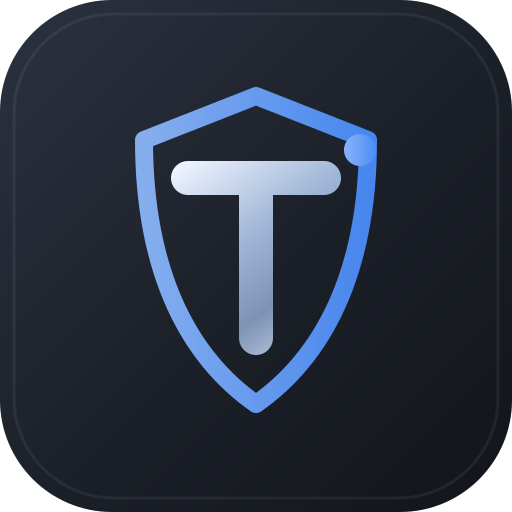
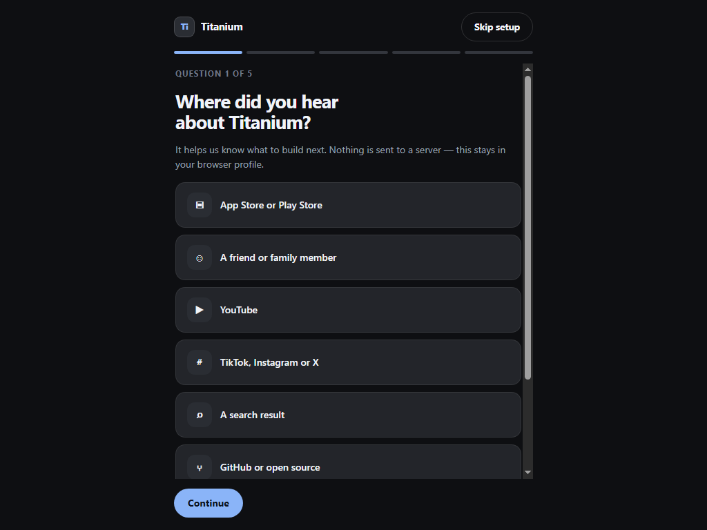
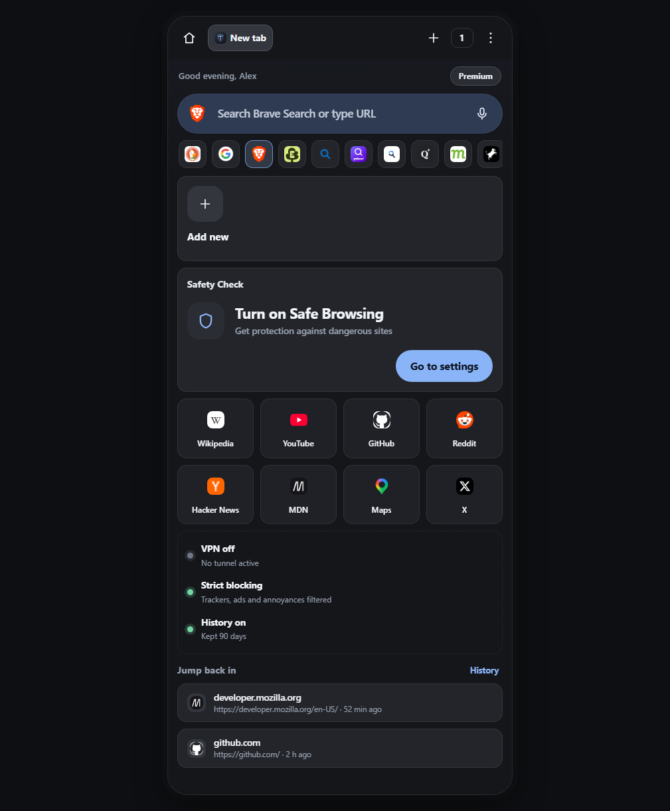
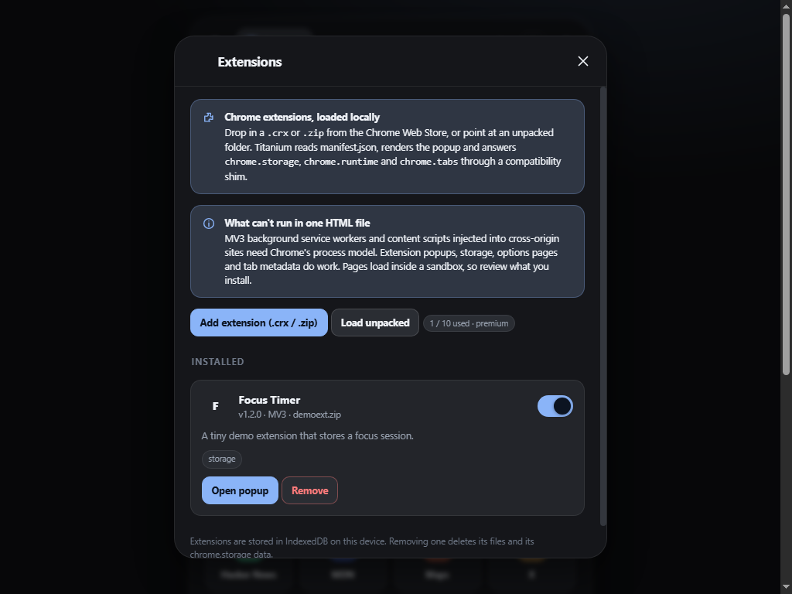
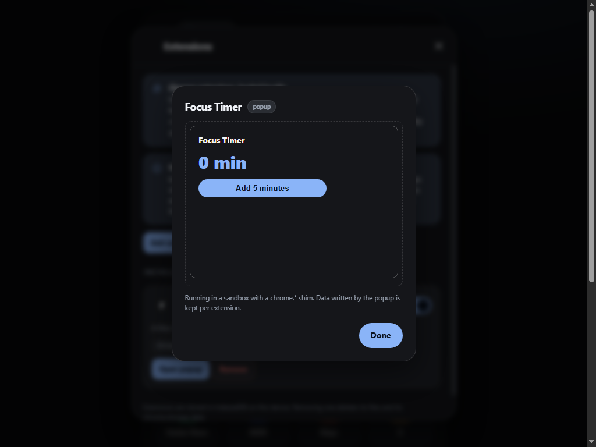
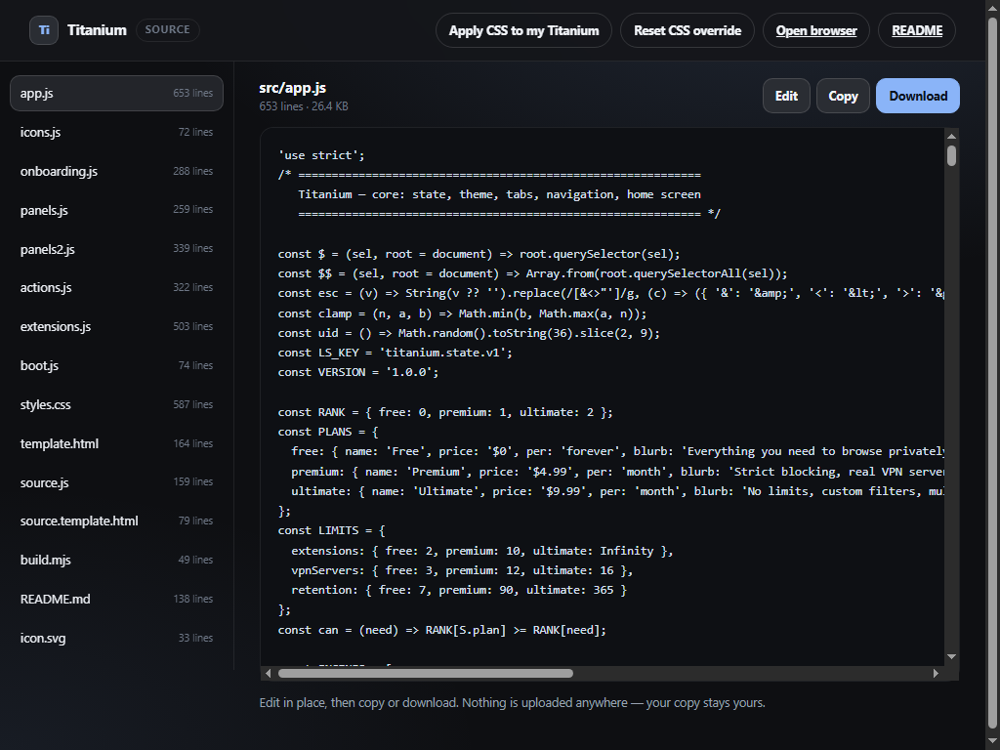
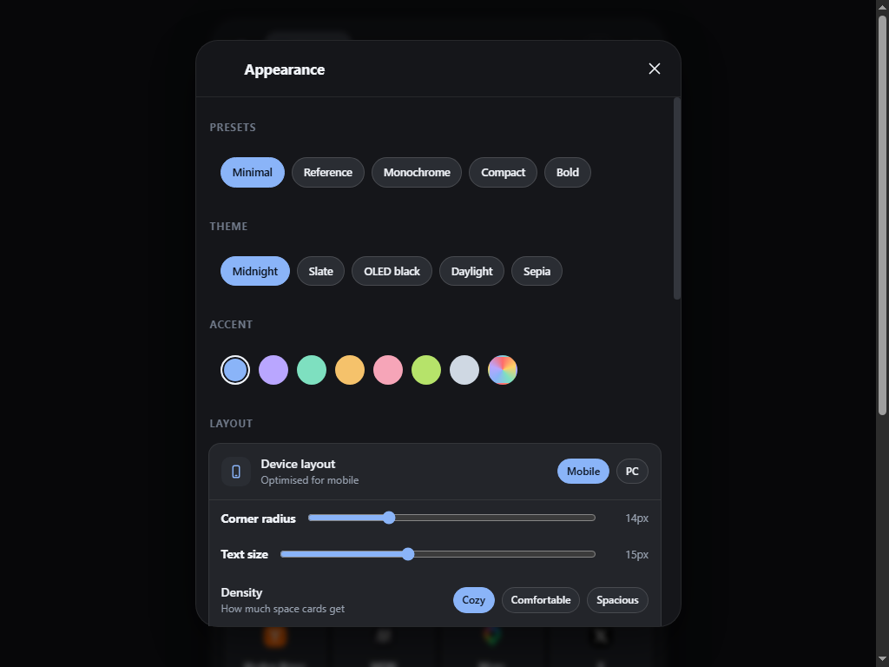
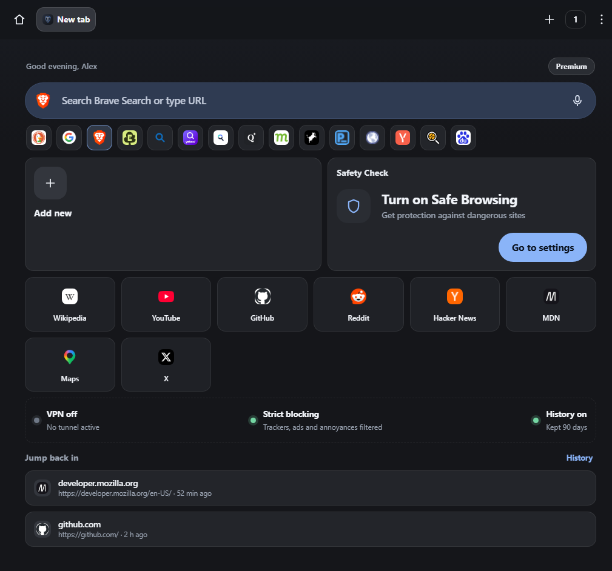

  

<h1 align="center">Titanium</h1>

<b>Metal for the web.</b> A private, deeply customizable browser that ships as one HTML file.

  
  
  
  

---

Titanium is a browser surface: a start page, real tabs, fifteen search engines with their real logos, ad blocking controls, a VPN surface, Chrome extension loading, history with scoped delegation, and three plans — all inside one HTML file with no framework, no network calls and no server.

Live at **https://njjjjjhij.github.io/titanium/** — no install, no account.

Watch the [45-second promo](promo.mp4), or open [source.html](source.html) to read and edit every line in the browser.

Open the file, answer five questions, and you land on a start screen shaped for the device you picked: full-bleed cards on mobile, a wider canvas on desktop.

## Screenshots

| Onboarding | Start page |
|---|---|
|  |  |

| Extensions | A real extension popup, running |
|---|---|
|  |  |

| Source browser, editable | Appearance, everything free |
|---|---|
|  |  |

The desktop layout, with the full fifteen-engine strip:

## Two files, one project

**index.html** is the browser. That is the whole product — open it and browse. Nothing to install, nothing to compile, no package manager, no account.

**source.html** is a working source browser. It carries every source file inside it, shows them in tabs, lets you edit them in place, copy them, download them, and — for the stylesheet — apply your changes live to the Titanium running on your device. It is how you make the browser yours without setting up a toolchain.

The human-readable sources also sit in **src/**. The build is a single command, described under Make it yours.

## The five questions

| # | Question | What it configures |
|---|----------|--------------------|
| 1 | Where did you hear about us? | Stored locally. Never transmitted. |
| 2 | Mobile or PC? | Lays out the entire app immediately: card sizing, columns, tab strip, touch targets. |
| 3 | Who's browsing? | A local profile: display name, email and avatar colour. Guest and "later" are one tap. |
| 4 | Should Titanium remember where you've been? | History on or off, private-by-default tabs, retention window. |
| 5 | Who gets to see your history? | History delegation: keep it device-only, grant a scoped expiring code, or import someone else's. |

Every answer can be changed later, and **Skip setup** drops you on sensible defaults.

## Search, with real icons

A strip of the actual service logos sits under the search bar. Tap any icon and that engine becomes the one Titanium searches with — no menus, no dropdowns.

The fifteen engines are DuckDuckGo, Google, Brave Search, Ecosia, Bing, Yahoo, Startpage, Qwant, Mojeek, Swisscows, Presearch, SearXNG, Yandex, Baidu and Kagi. Icons are the real 64-pixel service marks, embedded as data URIs so the browser still works offline and makes no requests to fetch them. Ultimate adds a custom engine with any query template.

The same real marks follow your shortcuts, history rows and tab strip, so a page is recognisable at a glance. If you prefer a quieter look, switch icons to monochrome in Appearance.

## What else is inside

**Start page.** Search pill with engine mark, an Add new shortcut tile, a Safety Check card with live shield state, quick links, a compact status line for VPN, ad blocking and history, and jump-back-in recents. Each card can be turned off.

**Tabs.** Real tabs with per-tab back stacks, an icon-only strip on mobile, tab counts, and limits by plan.

**Ad and tracker blocking.** Four levels — Off, Balanced on Free, Strict on Premium, Aggressive on Ultimate — plus custom network and cosmetic filter rules on Premium and above. Safe Browsing, Do Not Track, HTTPS-only and third-party cookie controls sit beside them.

**VPN.** Sixteen locations, WireGuard, OpenVPN and IKEv2, a kill switch on Premium and split tunnelling on Ultimate, with a clear connected state.

**Chrome extensions.** Install a CRX or ZIP, or load an unpacked folder. Titanium reads the manifest, renders extension popups in a sandbox and answers chrome.storage, chrome.runtime, chrome.tabs and chrome.i18n through a compatibility shim. Storage is per extension, and removing one deletes its files and data.

**History and delegation.** Retention of 7, 90 or 365 days by plan, private tabs excluded, searchable list, one-tap clear and JSON export. Delegation turns a scoped snapshot into a code you can hand to another device; the codes are generated locally and every grant, import and revocation is written to an access log.

**Look and feel.** Five themes, seven accents plus any custom colour, five one-tap presets, corner radius and text size sliders, three densities, search bar shapes, colour or monochrome icons, and toggles for every start-page element. All of it is free.

## Plans

Free is the floor and stays useful forever. Each tier is strictly better than the one below it.

| | Free | Premium — $4.99/mo | Ultimate — $9.99/mo |
|---|---|---|---|
| Ad blocking | Balanced | Strict + custom filters | Aggressive + miner protection |
| VPN | 3 locations | 12 + kill switch | All 16 + split tunnelling |
| Extensions | 2 | 10 | Unlimited |
| History | 7 days | 90 days | 1 year |
| Delegation | — | 1 delegate | Up to 5 delegates |
| Tabs | 5 | 20 | Unlimited |
| Search | All 15 engines | All 15 engines | + custom engine |
| Appearance | Everything | Everything | Everything |

Plan switching in this build is a demo checkout: no card, no charge, and the entitlement flips locally so every gated feature can be tried.

## Make it yours

Titanium is deliberately easy to fork for yourself, in three ways.

The fastest is inside the app: open the menu, choose Source code, and you get the working source browser. Pick a file, hit Edit, change it, then download it or copy it. For the stylesheet there is an Apply CSS button that writes your edited CSS into this device's storage, so the browser restyles itself on the next reload. Reset CSS override undoes it.

The second is on disk. The sources live in the **src** folder as ordinary scripts and one stylesheet, with **build.mjs** stitching them into **index.html**. With Node installed, run the build with the command name that matches the file — the script is dependency-free, so nothing needs installing first. Edit anything, rebuild, reload.

The third is to fork the repository and publish your version with GitHub Pages. Point Pages at the repository root; **index.html** and **source.html** both work as plain static files.

Nothing phones home. There is no account server, no analytics and no telemetry, so a fork is fully independent.

## Icons and trademarks

The search engine, site and app marks are the real 64-pixel icons published by each service, embedded as data URIs. They are used only to identify the service you are choosing or the page you visited. All trademarks belong to their owners; Titanium claims no affiliation. The Titanium mark itself is the SVG in **icon.svg**, rasterised to **icon-512.png**.

## Honest limits

| Limit | Why | Path forward |
|---|---|---|
| Sites that forbid embedding cannot load in a tab | Only a top-level browser can ignore X-Frame-Options and frame-ancestors | A native shell, or open the page in your installed browser — Titanium offers exactly that button |
| The VPN is a simulated tunnel | A single HTML file has no network stack to encrypt | A native shell or a WireGuard helper process |
| Extension service workers and cross-origin content scripts do not run | They need Chrome's process model | Package Titanium as a real browser or extension host |
| Voice search needs the Web Speech API | Browser support varies | It already degrades to a clear message |

When a page refuses to load, Titanium says so plainly and offers to open it outside. It never pretends a page rendered.

## Privacy

No analytics, no telemetry, no accounts server, no cookies set by Titanium. Your profile, plan, history, shortcuts, extensions and delegation codes stay on the device. Reset Titanium wipes all of it, and deleting the local profile from the Account panel does the same.

## Contributing

Issues and pull requests are welcome. Keep it dependency-free, keep **index.html** and **source.html** as the shipped artefacts, keep the rebuild to one command, and keep the honest-limits section honest. Regenerate both HTML files before opening a pull request.

## Roadmap

- Optional native shell for a real VPN and unfiltered tabs
- Download manager and reader mode
- A content-script sandbox for same-origin tabs
- Tab groups and pinned tabs
- Encrypted delegation codes

## Licence

MIT. See **LICENSE**. Fork it, ship it, rename it.
